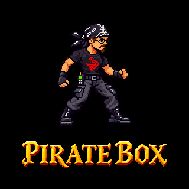

# Pirate Box 0.1.0 — square display firmware

Pirate Box is pirate-themed firmware for square displays, beginning with the **Waveshare ESP32-C5-LCD-2.73**. Its own animated interface uses the owner's pixel-art avatar, vivid gold/coral/cyan accents, a full-square radar and dedicated weather station. The detection, evidence, radio tools and storage services build on **Dragon Detector 0.13.42**, with a dedicated C5 display/input/sensor adapter.

The current target is a 320 × 320 LCD with physical buttons. The boot animation opens six launcher cards: **RADAR / WEATHER / BLE LAB / ATTACKS / TOOLS / SETTINGS**. More square boards need their own hardware profiles and validation.

<p align="center"></p>

The image above is reconstructed from the exact embedded RGB565 boot artwork, not a photograph of the physical screen. [All four boot frames](media/piratebox-avatar/boot-packed-preview.png) · [Artwork source and prompts](media/piratebox-avatar/README.md)

## Interface and features

- An original Pirate Box theme, with additional maker/locksport palettes including 44Delta, Moki, Law Lock Tools, Argyle and VectorPotential, plus a personal-theme slot. Dragon Ball and Capsule branding are excluded from Pirate Box's selectable designs.
- Full-square animated radar with a persistent, color-coded detection feed; fresh encounters advance the feed without repeated pop-up alerts. BLE Lab and the inherited Attacks menu have their own launcher cards. Device evidence, Hunt, encounter history, watch/ignore rules, recon notebook, captures and saved files remain available through Tools and Settings.
- Matching square analog/digital clock faces, **Settings → Time & Date** setup, stopwatch and theme-specific Locksport Timer, backed by the board's PCF85063 RTC.
- A dedicated **WEATHER** entry with live SHTC3 temperature/humidity, clock, battery estimate, SD/RTC status and IMU availability. QMI8658 acceleration/rotation measurements are available through board diagnostics.
- microSD logging and capture/wardrive storage paths; optional **ATGM336H / Generic NMEA GPS** configuration lives in **Settings → Radio & GPS → GPS setup** and starts disabled.
- **KeyL = previous, KeyR = next, BOOT = select**, with held Select for Back; **Settings → Controls** selects an optional rotary encoder, five-way joystick or five buttons through the CH32 expansion pins.
- Embedded avatar boot animation, a reactive radar/Recon mascot and pirate-style **PIRATE BOX** lettering, independent of the selected theme and SD card.

Settings groups controls into **Look & Feel**, **Time & Date**, **Detection**, **Data & Privacy**, **Radio & GPS** and **Controls**. Themes are under **Look & Feel → Themes & radar**; selection lists and BLE Lab/Recon panels use the full square display width.

Shared source availability does not establish C5 hardware parity. Radio modes, external GPS, service uploads and expansion controls need their own device checks. This board has no touch controller, speaker or onboard GPS. Its dual-band radio does not make every inherited radio workflow a validated dual-band implementation.

## Build and board guide

This repository publishes the **0.1.0 C5 source checkpoint tested on November 1, 2026** for the **ESP32-C5-LCD-2.73, 32 MB flash, 8 MB PSRAM**. Other board directories are retained shared source and upstream history, not released Pirate Box targets. See the [validation record](docs/PIRATEBOX-VALIDATION.md) and [checkpoint provenance](PIRATEBOX-CHECKPOINT.md).

```sh
git clone https://github.com/valleytechsolutions/Pirate-Box.git
cd Pirate-Box
```

The current build workflow uses Windows PowerShell and pinned local toolchain seeds. On a fresh machine, first follow the [provisioning prerequisites](docs/PIRATEBOX-SQUARE.md#build-artwork-and-validation): RISC-V compiler **14.2.0+20260121**, esptool **5.4.0**, and a Python bootstrap runtime. The compiler/framework cache is not bundled. Then use the isolated build wrapper from the repository root:

```powershell
./tools/build_piratebox_square.ps1
```

The wrapper keeps a private PlatformIO core, packages and compiler in `%LOCALAPPDATA%\PirateBoxSquare\platformio`, with its Python environment in the sibling `venv` directory. It sets `PIRATEBOX_TOOLCHAIN_DIR` and records source/image hashes. This avoids competing firmware projects replacing a shared framework during compilation. See the [Pirate Box square guide](docs/PIRATEBOX-SQUARE.md) for build/package options and flashing. The flash wrapper validates artifacts and the preserved backup by default; **`-Execute` performs the actual board write**.

The device identifies as **Pirate Box 0.1.0**, based on Dragon Detector **0.13.42**. This development tree does not publish or install a Pirate Box profile through the existing Dragon Detector public web flasher.

This initial publication provides the Pirate Box source; there is no Pirate Box binary release or hosted installer yet. Before flashing a local build, pass your actual serial port and your own 32 MiB board backup using `-Port` and `-Backup`. Historical script defaults belong to the original development setup.

The [complete SD resource bundle and installer](docs/PIRATEBOX-SD-RESOURCES.md) include the original 54,282-entry vendor pack, its provenance, a firmware-format BLE Lab demo profile, optional stock avatar badge archive and GPS/configuration guides. The USB installer verifies SHA-256 by full readback, adds missing files and preserves existing user files. Themes, fonts, decoders and boot artwork are already embedded in flash.

The board physically has **32 MB flash and 8 MB PSRAM**. Both 5 MiB app slots stay below 16 MiB. An independent **16 MiB `piratefs` volume** uses the upper half for internal data, while the earlier lower filesystem region is preserved. First use initializes the new volume only after reading the entire region and confirming every byte is erased; later mount failures never trigger formatting. microSD provides removable storage. [Partition source](hardware/waveshare-c5-273/partitions.csv)

## Source and credits

Original application, web and tooling code: [MIT](LICENSE), Your Pal Kal / Valleytech. Dragon Detector's upstream attribution and third-party notices remain in [CREDITS.md](CREDITS.md). Generated avatar derivatives, the original supplied image, exact generation prompts and reproducible asset packing are retained under [media/piratebox-avatar](media/piratebox-avatar/README.md).

The [inherited Dragon Detector README](README-DRAGON-DETECTOR.md) and existing guides describe upstream boards and history. Their hardware validation statements do not apply automatically to the C5. Pirate Box does not change the rights or notices associated with third-party libraries, logos, trademarks or artwork.
