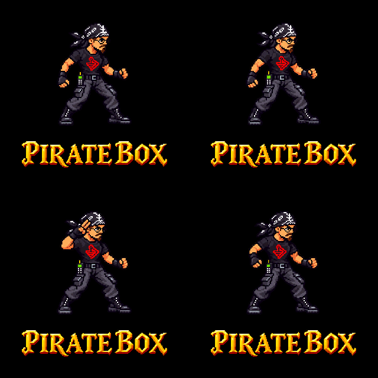

# Pirate Box square firmware — Waveshare ESP32-C5-LCD-2.73

Pirate Box **0.1.0** ports Dragon Detector **0.13.42** to the 320 × 320 square Waveshare C5 board. It keeps shared application modules and non-Dragon theme options, with a purpose-built square Pirate Box launcher, radar and sensor interface. The previous Marauder-derived PirateBox tree is separate.

## Hardware and storage

Waveshare documents 32 MB flash, 8 MB PSRAM, ILI9488 LCD, microSD, SHTC3 temperature/humidity, QMI8658 IMU, PCF85063 RTC and CH32 I/O expansion. The controls are GPIO2/KeyL, GPIO3/KeyR and GPIO28/BOOT. [Official board reference](https://docs.waveshare.com/ESP32-C5-LCD-2.73)

There is no touch controller, speaker or onboard GPS. Hardware Wi-Fi supports 2.4/5 GHz, but inherited radio workflows require separate C5 and band-specific validation. Zigbee/Thread hardware capability is not an implemented Pirate Box feature.

The [partition table](../hardware/waveshare-c5-273/partitions.csv) retains both 5 MiB app slots, the original `0x5E0000` lower filesystem region, NVS/OTA metadata and coredump below `0x1000000`. A separate 16 MiB `piratefs` data volume starts at `0x1000000`; no executable or OTA slot moves into that upper region. C5 Personal themes, badges, history and internal recon fallback share this LittleFS mount. The earlier lower filesystem is preserved without conversion.

First-use initialization requires the exact expected partition geometry, a 32 MiB flash chip, and a successful read of every byte showing an erased region. Nonblank contents, read failures and memory failures prevent initialization. Ordinary mounts use `formatOnFail=false`; a later mount error never reformats saved data. The initial blank scan yields cooperatively and adds several seconds before the first boot. Verify persistence and lower-region preservation on the physical board after introducing this layout.

C5 builds use NimBLE's supported PSRAM allocator for host data, leaving task stacks and controller allocations internal. A forced configuration header first loads the SDK defaults, then clears its conflicting internal-allocation flag; this matters because a standalone external-allocation `-D` would otherwise leave the internal branch active.

LCD and microSD share SPI GPIO5/6/7, with separate chip selects GPIO8/9. Sensors and the expander share I²C SDA27/SCL26. Use FAT/FAT32 microSD. [Waveshare interface reference](https://docs.waveshare.com/ESP32-C5-LCD-2.73/Arduino)

## Controls and menu

| Input | Action |
|---|---|
| KeyL / GPIO2 | Previous focus or lower edited value |
| KeyR / GPIO3 | Next focus or higher edited value |
| BOOT / GPIO28, short release | Select focused item |
| Hold Select | Exit field editing or navigate Back |

The avatar boot animation opens six square launcher cards: **RADAR**, **WEATHER**, **BLE LAB**, **ATTACKS**, **TOOLS** and **SETTINGS**. RADAR opens the live field directly. BLE LAB opens the inherited GATT/profile workspace; ATTACKS opens the inherited Wi-Fi/BLE tools menu. TOOLS contains RECON, UTILITIES and SYSTEM groups. GPS setup is under **SETTINGS → RADIO & GPS → GPS setup**. Focus is highlighted and lists scroll to the focused row. C5 direction events move focus immediately; Select completes its press/release in one LVGL input cycle, so an accepted key event cannot expire behind a slow redraw. Clock rollers use Select to edit, left/right to adjust, then Select to accept the field. Hold Select to return through the menu; HOME returns to the launcher cards.

Settings opens six categories:

| Category | Contents |
|---|---|
| LOOK & FEEL | Themes & radar, Display & timeouts, Screen orientation and Device color legend |
| TIME & DATE | Set time, Set date, Clock sync & time zone and Open clock |
| DETECTION | Detection filters, candidate/all-contact radar, auto quiet, quiet mode, signal smoothing and audio hardware status |
| DATA & PRIVACY | Display privacy, flash history, Watch / ignore list, Recon notebook, captures and SD event logging |
| RADIO & GPS | BLE scan mode, GPS setup, Radio health, Fox beacon and About Pirate Box |
| CONTROLS | Built-in buttons only, Rotary encoder, 5-way joystick and Five individual buttons |

**Settings → Look & Feel → Themes & radar** starts with the original **Pirate Box** theme: a black background, vivid gold/coral/cyan accents, an animated compass sweep and the supplied pirate avatar/wordmark. The radar field fills the 320 × 320 display for every C5 theme; alternative themes change its palette. Non-Dragon alternatives remain selectable from the shared catalog. C5 excludes the Dragon, Gold Dragon Ball and Capsule themes and Capsule watch face; other profiles retain their original IDs and choices. No mandatory SD theme pack is needed.

The selected theme also selects its matching clock face at startup and when changed. Clock arrows change both the face and the theme together, including persisted settings. Each C5 clock keeps its original proportional hands, emblem and animation, surrounded by a full-square palette background, perimeter seconds marker, date/RTC/battery corners and accessible corner controls. The Pirate face uses the supplied avatar; Dragon/Capsule faces remain excluded.

The radar integrates a three-row color-coded detection feed along the bottom. New encounters enter at the bottom and push older rows upward; repeated adverts update their existing encounter instead of flooding the feed. A fixed 32-encounter memory bound prevents growth. Dots and callouts stay above the feed while the animated field covers the entire square. Accepted visible tracker and other non-alert families appear too; detector visibility, mode, ignored/snoozed devices and privacy rules still apply. Detection popups are suppressed on this button-only profile. A small animated avatar occupies the top-right of Radar and the general Recon header. It reacts to each new accepted encounter with a family-specific pose and a short colored caption; repeated adverts do not continually restart the reaction. The caption exposes the family only, and follows the same visibility and privacy rules as the feed. Signal plots show relative signal strength and are not geographic bearings or measured distance. The C5 animation requests a 50 ms frame interval; actual frame rate depends on rendering and LCD transfer time.

BLE Lab and Recon use full-width square panels with fixed Home/Back/Stop controls. BLE Lab notification updates preserve the selected control and an in-progress editor when the device and attribute remain the same. Nearby devices follow their exact address and address type; saved profiles follow their filename, so list reordering cannot move selection to a different device. A pending Select is cancelled when widgets are rebuilt. Settings and selection pages use the same square row layout and preserve the selected action when a setting redraws its current section.

Long device/evidence text, notebook statistics, Activity and Radio Health have a separate reading control. Focus the outlined content area and press **BOOT** to enter reading mode; **KeyL/KeyR** scroll by a quarter-page. Press BOOT or hold it to exit reading mode, then navigate to the page actions or Home/Back. Ordinary item lists continue to scroll automatically with their focused row.

Pirate Box always starts at the launcher after its avatar animation, including after a badge upload. A saved badge remains available from Tools; inherited badge-startup flags do not bypass the launcher on C5. **Look & Feel → Open radar** opens the live field immediately and does not alter startup. Other board profiles retain their original badge-startup option.

## Weather, motion and RTC

Open the dedicated **WEATHER** launcher card (also available under TOOLS → UTILITIES) for Celsius/Fahrenheit, humidity, time/date, estimated battery voltage/percentage, SD/RTC status and IMU availability. SHTC3 measurements are sampled outside rendering, CRC-checked and retried on failure. This is a local sensor station, with no Internet forecast service.

**Settings → Time & Date** provides **Set time**, **Set date**, **Clock sync & time zone** and **Open clock**. The clock editor also has TIME, DATE and SYNC tabs; select **TIME ZONE** on SYNC to adjust the local UTC offset. These controls configure the PCF85063. Pirate Box does not interrupt startup with an automatic clock-setup popup. Reads reject invalid calendar/BCD values and oscillator-stop state. Clock retention requires RTC power or backup power; firmware cannot retain time while all supplies are disconnected. Battery percentage is an estimate.

USB diagnostics, at 115200 baud:

```text
board health
weather status
imu status
clock status
input status
radar feed status
radar themes
```

## Optional external controls

**Settings → Controls** opens EXPANSION CONTROLS, with **Built-in buttons only**, **Rotary encoder**, **5-way joystick** and **Five individual buttons** choices. These assignments are **CH32 EXIO numbers**, not ESP32 GPIO numbers. Built-in controls remain available.

| Mode | Default mapping |
|---|---|
| Encoder | EXIO4=A, EXIO5=B, EXIO6=press |
| Joystick/five buttons | EXIO4=up, EXIO5=down, EXIO6=left, EXIO7=right, EXIO8=select |

Use contacts to ground, individual external pull-ups to **3.3 V** and a shared ground; enable the mode after wiring. Only unique EXIO4–EXIO14 assignments are accepted. Expansion pins remain inputs, excluding display reset/power functions. Direction switches provide previous/next focus, not analog joystick coordinates.

Custom USB mappings:

```text
input encoder 4 5 6
input joystick 4 5 6 7 8
input buttons 4 5 6 7 8
input off
```

External encoder/joystick/button hardware remains physically unvalidated, including reliable encoder speed over the shared I²C bus.

## GPS, SD and inherited tools

Optional NMEA GPS uses **GPIO12/RX** at the UART connector: receiver TX plus common ground, 3.3 V signal levels, module powered at its specified voltage. Receiver RX is unnecessary. Enable it under **Settings → Radio & GPS → GPS setup**, or send:

```text
gps external on 12 9600
gps external status
gps external off
```

GPS starts disabled. Located logs require a receiver and fresh valid fix. Wardrive, capture/file handling and upload controls come from the Waveshare AMOLED SD/GPS paths, including stop/save before leaving sessions. WiGLE/WDGoWars uploads require configured credentials; source availability or compilation does not establish authenticated upload success.

See [SD resources and verified installation](PIRATEBOX-SD-RESOURCES.md) for the complete staged bundle, existing-file preservation, BLE Lab demo profile and the distinction between card resources and embedded features. The SD installer reads back each installed file and checks SHA-256. After installing the vendor pack, restart and confirm `resources status` reports `status=ready` and `entries=54282`.

Detector evidence, history, BLE Lab, GATT operations, Remote ID parsing, recon/capture and other inherited radio functions require C5 device validation. Signal strength is not distance; a signature match does not prove ownership or intent. Missing touch/audio/GPS hardware cannot be supplied by this profile.

## Build, artwork and validation

Run the build wrapper from the repository root. An explicit artifact directory keeps a complete package separate from the incremental build cache:

```powershell
./tools/build_piratebox_square.ps1 -Clean -ArtifactDirectory '.\.work\piratebox-square-package'
```

The wrapper keeps PlatformIO's core/packages and compiler in `%LOCALAPPDATA%\PirateBoxSquare\platformio`, and a private Python environment in `%LOCALAPPDATA%\PirateBoxSquare\venv`. It sets `PIRATEBOX_TOOLCHAIN_DIR` for the environment-backed `platform_packages` entry, so concurrent projects cannot replace its framework/compiler. Use the wrapper rather than invoking a global `pio` installation; `-CacheRoot` selects a different private root. The environment pins pioarduino `55.03.312`; the checked-in bootloader selected by `hardware/waveshare-c5-273/pio_bootloader.py` must stay matched to that framework. A build receipt ties source hashes, partition geometry and binary hashes together.

First provisioning copies verified RISC-V compiler `14.2.0+20260121` and esptool `5.4.0` seeds from the local `.platformio\tools` tree, then creates the private Python environment and installs pinned PlatformIO. On another machine, provide matching seeds to `tools/provision_piratebox_square.ps1` with `-SeedToolDirectory` and, if needed, `-SeedPython` before running the build wrapper. The scripts fail explicitly when required tools are absent or have unexpected versions.

Validate the package and the preserved 32 MiB backup without opening a serial port:

```powershell
./tools/flash_piratebox_square.ps1 -ArtifactDirectory '.\.work\piratebox-square-package' -Port COM79
```

For the connected authorized C5 board, add **`-Execute`** to perform the write:

```powershell
./tools/flash_piratebox_square.ps1 -ArtifactDirectory '.\.work\piratebox-square-package' -Port COM79 -Execute
```

The flash wrapper verifies the build receipt and backup, checks the connected C5's physical flash size, writes bootloader/partition/OTA-selector/application regions and independently verifies the written bytes. Use `-Backup` for a different preserved backup. Successful transfer does not establish standalone boot or control/display behavior; confirm those after reset/power cycle. The application region begins at `0x10000`; the transfer excludes NVS, filesystem contents and SD files. At first boot the firmware may initialize the new upper `piratefs` volume only after its complete blank check. Bootloader and application headers declare 32 MB; the ROM bootloader header must be DIO even though the second stage enables QIO.

Repack existing artwork only after changing its assets:

```powershell
./tools/pack_piratebox_boot.ps1
```

[Boot asset provenance](../media/piratebox-avatar/README.md) retains the supplied original, generated transparent sheet/title, exact prompts, packed bytes, checksums and 320 × 320 previews. The square stock badge uses the same avatar/title; other boards' historical badge arrays remain intact.



This preview is reconstructed from firmware RGB565 bytes, not a physical display photograph. Host checks/builds do not establish LCD appearance, physical key operation, external control reliability, RTC power-loss retention, sustained SD behavior or radio/GPS accuracy. Record physical checks separately. This development tree does not publish a Pirate Box web-installer profile.

Upstream credits remain in [CREDITS.md](../CREDITS.md), and the original overview is preserved as [README-DRAGON-DETECTOR.md](../README-DRAGON-DETECTOR.md).
